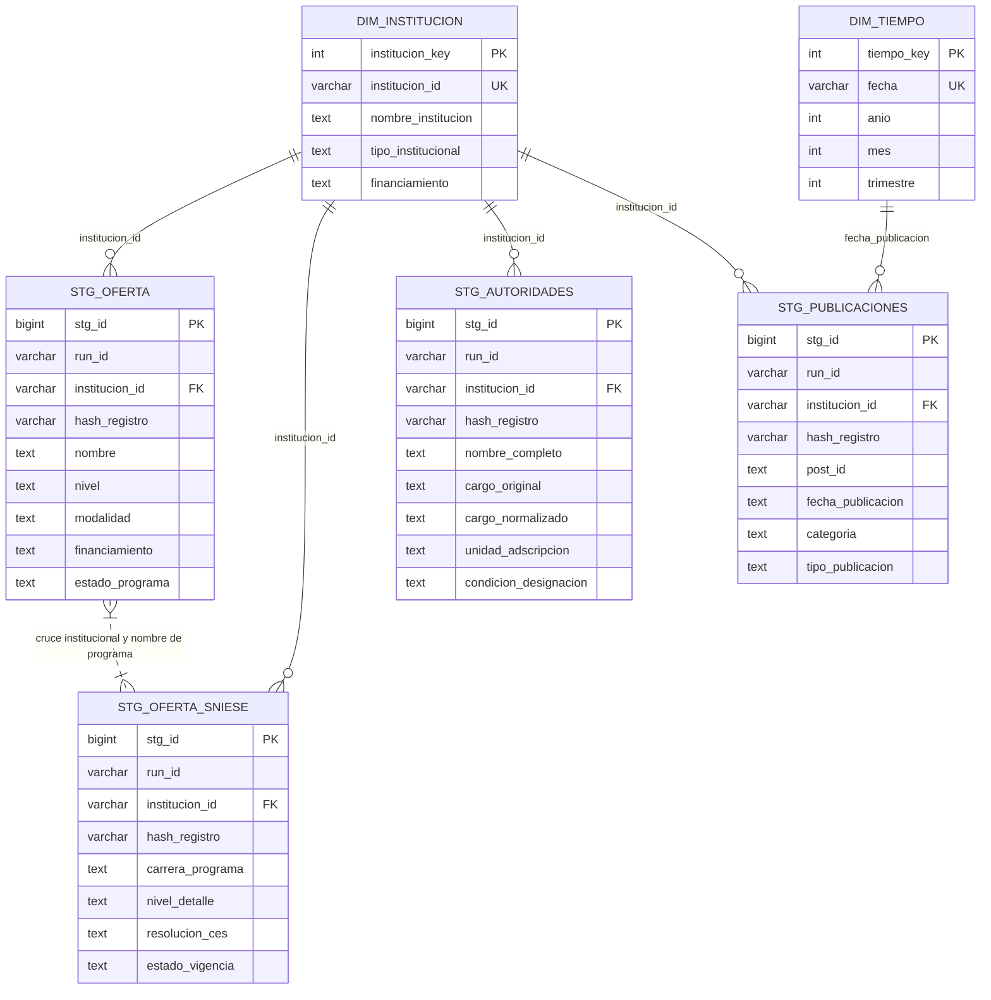

# Claves de Unión y Linaje entre Fuentes — Hito 2

**Proyecto:** Business Intelligence — Universidades Ecuador (Equipo 6, FIS-EPN)  
**Entregable:** H6 — Claves de Unión de Datos  
**Ámbito:** Esquema `stg` (Staging crudo) y modelo dimensional de destino

---

## 1. Claves Conformadas Principales

Para integrar las diferentes fuentes (portal web institucional EPN, pilotos ESPE/USFQ y catastro nacional SNIESE/CES), se establecen claves estándar de unión e interoperabilidad:

### 1.1. `institucion_id` (Clave Conformada Principal)
- **Tipo:** `VARCHAR(32)` / `TEXT`
- **Valores:** Código alfanumérico estandarizado en mayúsculas (`EPN`, `ESPE`, `USFQ`, `UCE`, etc.).
- **Presencia:** Presente en **todas** las tablas staging (`stg_oferta`, `stg_autoridades`, `stg_publicaciones`, `stg_oferta_sniese`).
- **Función:** Conecta las tres preguntas de negocio (P1: oferta, P2: autoridades, P3: publicaciones) a la misma dimensión institucional conformada (`dim_institucion`).

### 1.2. `hash_registro` (Idempotencia y Unicidad Física)
- **Tipo:** `VARCHAR(64)` (SHA-256 de 20 caracteres hexadecimales)
- **Función:** Garantiza que ningún registro duplicado ingrese al esquema `stg`. Calculado sobre el contenido semántico excluyendo metadatos de auditoría.
- **Constraint:** `UNIQUE (run_id, hash_registro)` en todas las tablas `stg`.

### 1.3. `run_id` (Linaje de Ejecución)
- **Tipo:** `VARCHAR(64)` (UUIDv4 generado por ejecución)
- **Función:** Permite la carga incremental versionada (`append`), agrupando todos los registros extraídos durante una misma corrida del pipeline sin sobreescrituras destructivas.

---

## 2. Claves de Entidad de Negocio por Pregunta

| Pregunta de Negocio | Entidad | Clave Compuesta de Unión | Tablas que la Comparten |
|---|---|---|---|
| **P1 — Oferta Académica** | Programa Académico | `(institucion_id, nombre, nivel, modalidad)` | `stg_oferta` ↔ `stg_oferta_sniese` ↔ `dim_carrera` |
| **P2 — Autoridades** | Cargo / Autoridad | `(institucion_id, nombre_completo, cargo_original, unidad_adscripcion)` | `stg_autoridades` ↔ `dim_autoridad` / `dim_cargo` |
| **P3 — Publicaciones** | Noticia / Comunicado | `(institucion_id, post_id)` | `stg_publicaciones` ↔ `fact_comunicacion_institucional` |
| **Conformada — Tiempo** | Periodo Temporal | `fecha_extraccion` (ISO 8601) / `fecha_publicacion` / `fecha_observacion` | Todas las tablas `stg` ↔ `dim_tiempo` |

---

## 3. Matriz de Integración entre Fuentes

### 3.1. Cruce P1: Portal Web (`stg_oferta`) vs Catastro SNIESE (`stg_oferta_sniese`)
- **Objetivo:** Contrastar la oferta académica publicada en el portal con la oferta formal aprobada por el CES.
- **Clave de cruce:**
  ```sql
  stg_oferta.institucion_id = stg_oferta_sniese.institucion_id
  AND LOWER(stg_oferta.nombre) = LOWER(stg_oferta_sniese.carrera_programa)
  AND stg_oferta.nivel_detalle = stg_oferta_sniese.nivel_detalle
  ```
- **Claves sustitutas resultantes en DW:**
  - `oferta_key` (SK en hechos de oferta académica)
  - `carrera_key` (SK en dimensión carrera)
  - `institucion_key` (SK en dimensión institución)

### 3.2. Cruce P2: Autoridades Universitarias
- **Objetivo:** Trazabilidad de cargos decanales y centrales.
- **Clave de cruce con estructura académica:**
  ```sql
  stg_autoridades.institucion_id = dim_institucion.institucion_id
  AND stg_autoridades.unidad_adscripcion = dim_facultad.nombre
  ```

### 3.3. Cruce P3: Publicaciones Institucionales
- **Objetivo:** Análisis temporal e institucional de noticias y comunicados.
- **Clave de cruce temporal:**
  ```sql
  stg_publicaciones.fecha_publicacion = dim_tiempo.fecha
  AND stg_publicaciones.institucion_id = dim_institucion.institucion_id
  ```

---

## 4. Diagrama de Relaciones y Linaje (Mermaid)



---

## 5. Decisiones de Diseño sobre Claves

1. **Sin claves foráneas estrictas en Staging:** Como Staging es la zona cruda de aterrizaje, no se implementan restricciones de integridad referencial (FOREIGN KEY) entre tablas `stg`, para evitar que un lote falle por desfases de carga entre fuentes.
2. **Idempotencia Garantizada:** Las restricciones de unicidad `(run_id, hash_registro)` y la verificación en `StagingLoader` evitan cargas duplicadas durante reintentos.
3. **Resolución en ETL:** La resolución de claves foráneas hacia las dimensiones conformadas (`dim_institucion`, `dim_tiempo`, `dim_facultad`) ocurre en la fase de Transformación (Hito 3 y Hito 4).
